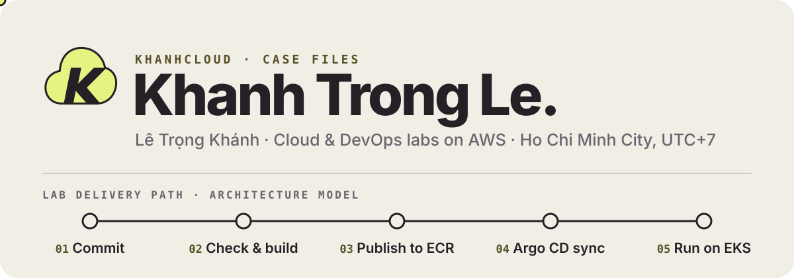

<picture>
  <source media="(prefers-color-scheme: dark)" srcset="assets/header-dark.svg">
  
</picture>

  
  
  

<b>Open to junior and associate Cloud &amp; DevOps roles, including remote (UTC+7).</b>

---

I build university and personal Cloud/DevOps labs on AWS and write each one up as a **case file**: the problem, the exact Terraform or pipeline lines at a pinned commit, and a scope note that separates what was applied from what is design. The labs cover Terraform for Amazon EKS networking, Jenkins → Argo CD delivery and private S3 for build artifacts. OrderFlow, a containerised order API, is the one I am taking to AWS next.

## Case files.

<table>
<tr>
<td width="50%" valign="top">

### AWS DevSecOps delivery lab
   

- Parameterised Jenkins pipeline for Terraform `init` / `validate` / `plan` / `apply` / `destroy`
- EKS module inputs for networking, node capacity, cluster access and add-ons
- Argo CD Application declared with automated prune and self-heal
- Scope: university architecture lab; configuration, not a recorded rollout

**[Read the case file →](https://khanhcloud.online/work/aws-devsecops/)** · [Repository](https://github.com/iam-trongkhanh/End-To-End-K8s-Devops-Project)

</td>
<td width="50%" valign="top">

### Amazon EKS with Terraform
   

- Separate VPC, EKS, managed node group and IAM modules
- Private worker subnets; NAT egress shared or one per Availability Zone
- KMS for Kubernetes Secrets, control-plane logs, OIDC provider for IRSA
- Scope: infrastructure code and docs; not applied for the write-up

**[Read the case file →](https://khanhcloud.online/work/eks-terraform/)** · [Repository](https://github.com/iam-trongkhanh/EKS-Terraform)

</td>
</tr>
<tr>
<td width="50%" valign="top">

### Private S3 for build artifacts
   

- Private bucket, ACLs disabled, versioning on
- CI role may upload only to the release prefix; requests without TLS denied
- SSE-KMS with a customer-managed key; S3 data events in CloudTrail
- Existing resources imported into Terraform until the plan showed no changes

**[Read the case file →](https://khanhcloud.online/work/secure-artifact-storage/)** · Completed personal lab

</td>
<td width="50%" valign="top">

### OrderFlow
   

- Order API with separate liveness (`/healthz`) and readiness (`/readyz`) checks
- Docker Compose stack, forward-only SQL migrations under an advisory lock
- Unit, integration (real PostgreSQL container) and Compose tests; Prometheus metrics
- Scope: local Docker Compose stack; AWS infrastructure in progress, no cloud resources provisioned yet

**[Repository →](https://github.com/iam-trongkhanh/orderflow-aws-devops)**

</td>
</tr>
</table>

## Toolbox.

**Cloud &amp; infrastructure** &nbsp;
   

**Delivery** &nbsp;
  

**Application** &nbsp;
   

## Activity.

<picture>
  <source media="(prefers-color-scheme: dark)" srcset="https://raw.githubusercontent.com/iam-trongkhanh/iam-trongkhanh/output/activity-dark.svg">
  
</picture>

Generated daily by <a href=".github/workflows/activity.yml">a workflow in this repo</a>. Case files are written in English; each one ends with an evidence &amp; scope note.
